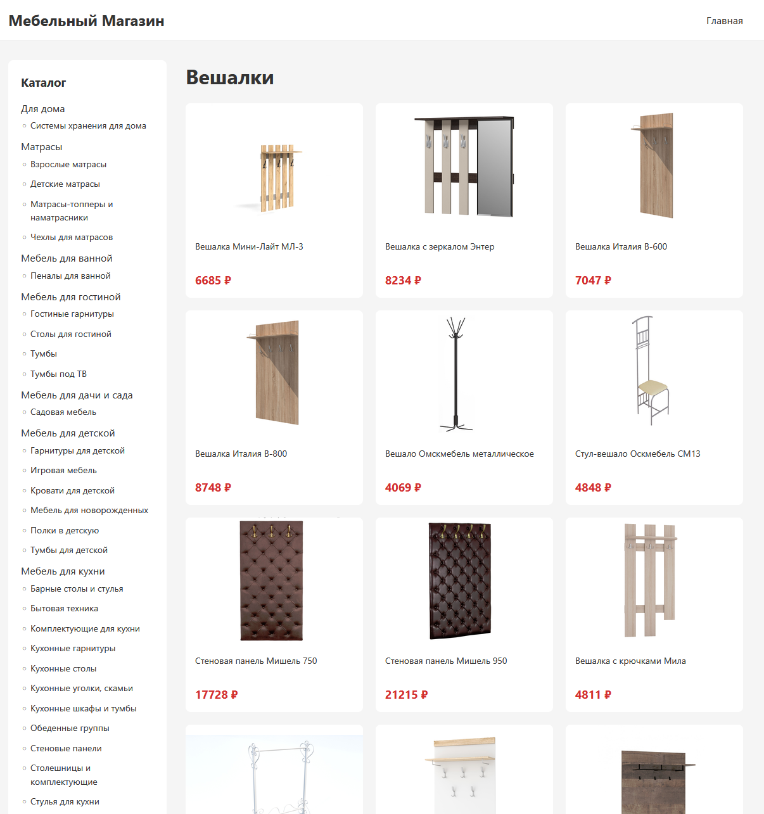
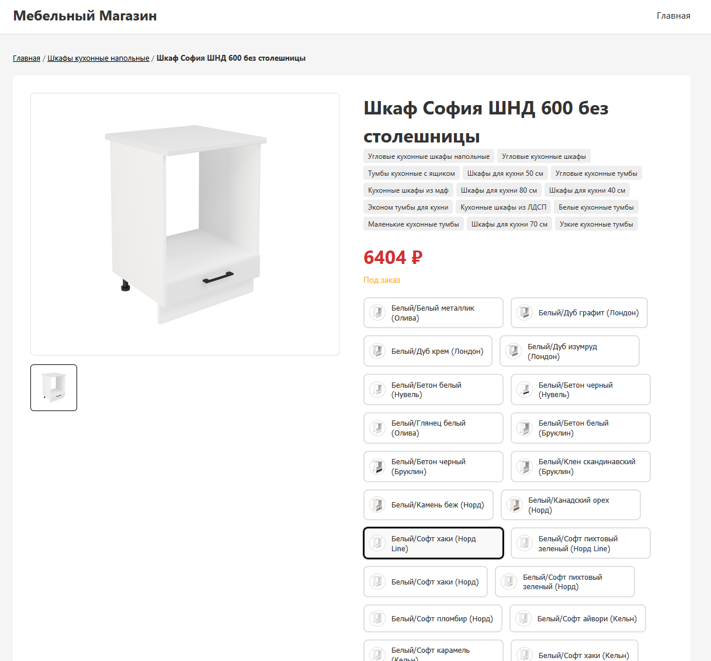

# 🛒 AI Catalog — E-commerce Parser & Analytics

Комплексная система для сбора, нормализации и визуализации данных интернет-магазина мебели.

## 📸 Скриншоты интерфейса

**Страница каталога:**

**Карточка товара с переключением цветов и характеристиками:**

## 🎯 Проблема
Сбор структурированных данных (цены, характеристики, комплектующие) с сайтов, защищенных от парсинга, и их отображение в удобном интерфейсе.

## 🛠 Стек технологий
*   **Парсинг:** Python, Playwright (обход защиты, перехват XHR).
*   **Backend:** Flask, SQLite (сложные связи Many-to-Many).
*   **Frontend:** HTML, CSS, Vanilla JS.
*   **DevOps:** Docker, Docker Compose.

## 🏗 Архитектура
1.  **Extract:** Сбор данных через API и эмуляцию браузера.
2.  **Transform:** Нормализация данных (связывание вариаций товаров, составов комплектов).
3.  **Load:** Сохранение в реляционную БД SQLite.
4.  **UI:** Отображение через Flask (динамическое переключение цветов, галереи, BOM).

## 🚀 Как запустить (Демо)
Проект упакован в Docker. В репозитории есть демо-база `demo_catalog.db`.
1. Склонируйте репозиторий.
2. Выполните: `docker-compose up --build`
3. Откройте: `http://localhost:5000`

*(Скриншоты интерфейса прилагаются)*

> **Note:** Реальный парсер и база данных являются коммерческой тайной и не публикуются в открытом доступе. В репозитории представлен демонстрационный интерфейс и архитектура.